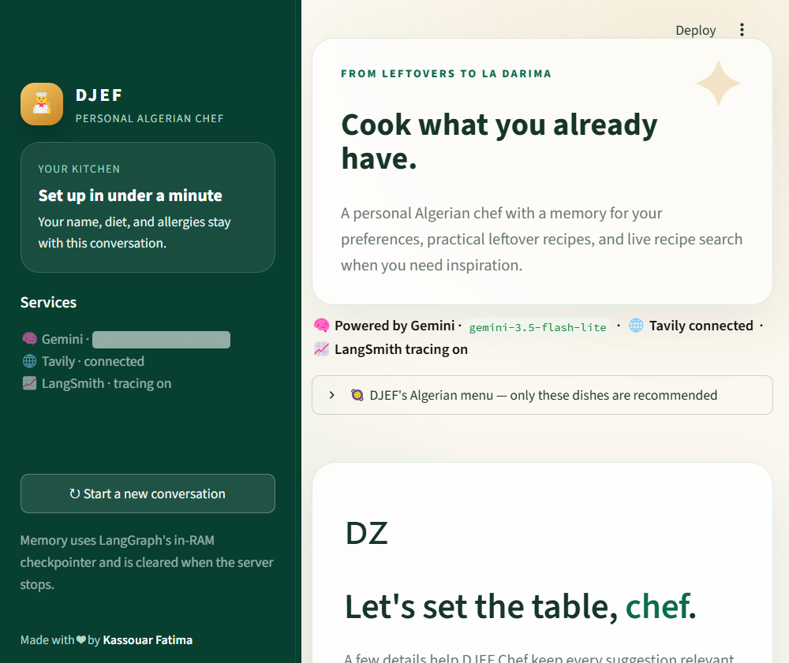
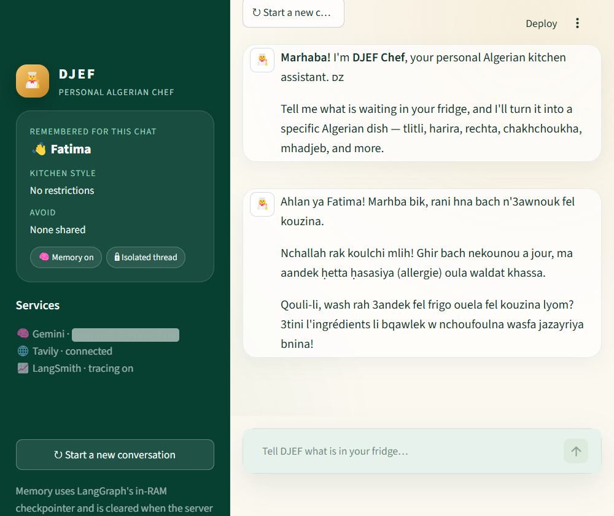

# 📘 LangChain — Module 1: Create Agent

> **Learning path:** LangChain & LangGraph, from a single model call to a stateful AI assistant.
> **Author:** Kassouar Fatima 🇩🇿
> **Stack:** Python · LangChain · LangGraph · Gemini · Tavily

This repository holds **Module 1 of the LangChain path** — "Create Agent": **4 training
notebooks** (foundational models, tools & web search, short-term memory, multimodal messages)
**+ the end-of-module project**: **DJEF**, a personal Algerian chef that is conversational,
tool-using, and remembers your preferences.

---

## 📷 The app in action

Here is the Streamlit app from the end-of-module project (`djef_chef/`):

| Onboarding — set up your kitchen | Chat — the chef answers |
| --- | --- |
|  |  |

> On the left: ~1-minute setup (name, diet, allergies) — stored once in the LangGraph thread.
> On the right: the chef replying in the chat, memory already loaded ("👋 Fatima").

---

## 📂 Repository layout

```
Module 1 - Create Agent/
│
├── notebooks/            ← 4 lessons (follow in order)
│   ├── 1_1_Creation_Agent_foundational_models_kassouar.ipynb
│   ├── 1_2_Tools_and_web_search_kassouar.ipynb
│   ├── 1_3_Short_term_memory_kassouar.ipynb
│   ├── 1_4_Multimodal_messages_kassouar.ipynb
│   └── assets/           ← image + audio used by lesson 1_4
│
├── screenshots/          ← app screenshots shown above
│
└── djef_chef/            ← end-of-module project: DJEF, the AI Algerian chef
    ├── notebook/         ← the agent core + teaching notebook
    ├── streamlit/        ← the chat web app
    ├── studio_simulation/← graph simulation (terminal + Studio)
    ├── scripts/          ← demo GIF generator
    ├── tests/            ← test suite (82 tests)
    └── README.md         ← full project docs
```

---

## 🎓 The 4 lessons (notebooks)

| Lesson | Title | What you learn | API key needed |
| --- | --- | --- | --- |
| `1_1` | Foundational models | Call a model (Gemini/Ollama), wrap it in an agent, control temperature / tokens / retries, streaming | `GOOGLE_API_KEY` |
| `1_2` | Tools and web search | Give the agent tools: Python functions + **web search** (Tavily) — the *Action → Observation* loop | `GOOGLE_API_KEY` + `TAVILY_API_KEY` |
| `1_3` | Short-term memory | The forgetting problem, the **checkpointer**, the **thread id** | `GOOGLE_API_KEY` |
| `1_4` | Multimodal messages | Send **image + audio** to the same agent (content blocks, base64, `mime_type`) | `GOOGLE_API_KEY` |

> 💡 Each notebook is self-contained: copy `.env.example` to `.env`, or paste the key in the
> setup cell / Colab Secrets.

---

## 🍲 End-of-module project: DJEF — Personal Algerian Chef

A conversational agent that turns **leftover ingredients into specific Algerian dishes**
(tlitli, harira, rechta, chakhchoukha, mhadjeb, tagines…). It combines **all of Module 1**:

- ✅ **Lesson 1_1** → a Gemini model (`gemini-3.5-flash-lite`)
- ✅ **Lesson 1_2** → two tools: a leftover matcher + Tavily web search
- ✅ **Lesson 1_3** → short-term memory (LangGraph + checkpointer)
- ✅ **Lesson 1_4** → structured messages (typed graph state)


### Project entry points

| Entry point | Command |
| --- | --- |
| Notebook | Double-click `run_notebook.cmd` → Run All Cells |
| Terminal sim | `uv run python studio_simulation/simulate.py` |
| Web app | `uv run streamlit run streamlit/app.py` |

> Complete setup, tests and prompt examples are documented in **`djef_chef/README.md`**.

---

## 🔑 API keys (never committed)

| Variable | Where to get it |
| --- | --- |
| `GOOGLE_API_KEY` | https://aistudio.google.com/apikey (Gemini) |
| `TAVILY_API_KEY` | https://app.tavily.com (web search) |
| `LANGSMITH_API_KEY` | https://smith.langchain.com (optional tracing) |

Create a local `.env` file (copy of `.env.example`) — `.env` is git-ignored, so your keys
**never** leave your machine. 🔒
