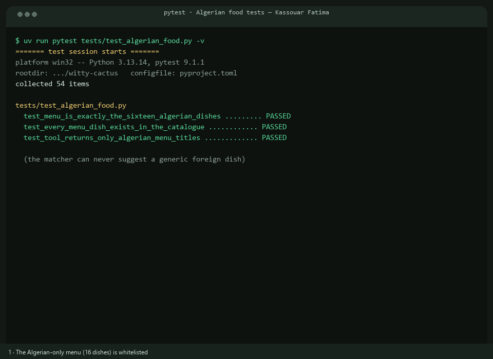
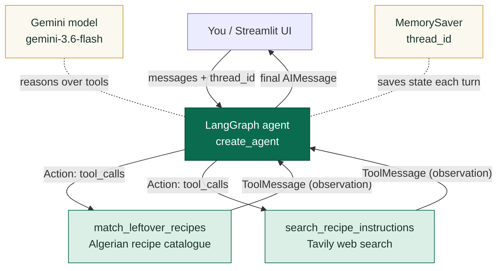

# DJEF — Personal Algerian Chef 🇩🇿

A local conversational cooking assistant built **from scratch** on the patterns taught in the
supplied LangChain notebooks (`1_1` … `1_4`): a Gemini model, two tools (an Algerian leftover
matcher and a Tavily web search), and LangGraph short-term memory. It turns leftovers into
**specific Algerian dishes only** — tlitli, harira, rechta, chakhchoukha, mhadjeb, tagines,
and more.

> **Built with:** Python 3.11+, Streamlit, LangChain, LangGraph, Gemini, and Tavily.
>
> **Author:** Kassouar Fatima.
>
> **Three entry points:** `notebook/` (the agent + teaching notebook) ·
> `studio_simulation/` (terminal + LangGraph Studio) · `streamlit/` (the web app).

---

## Demo (GIF)

<p align="center">
  
  <br/>
  <em>The animated demo: the Algerian-food test suite (menu whitelist, English /
  French / Arabic matching, foreign-food rejection) followed by the app in action.
  Regenerate with <code>uv run python scripts/make_demo_gif.py</code></em>
</p>

---

## Quickest test — one double-click (no servers)

To try the agent without typing a single command and without running any web server:

1. Double-click **`run_notebook.cmd`** — a browser tab opens with JupyterLab.
   - On a *new machine*, double-click **`setup_and_run_notebook.cmd`** instead: it installs
     `uv` and all packages automatically, then starts the notebook.
2. In the file list, open the **`notebook`** folder → double-click **`DJEF_Chef.ipynb`**.
3. Click **`Run` → `Run All Cells`** and wait for the spinners to finish.

The notebook needs **no other server**: cell 7 runs the very same graph the apps use, and the
final cell runs the **full 82-test offline suite** right inside the notebook. The same tests
also run headlessly with `uv run pytest`.

> **Free-tier quota (normal, not a bug):** the free Gemini tier allows about 10 calls per
> minute and ~20 per model per day; one full "Run All" uses about 8 calls. The notebook
> retries automatically and, if a call still fails, prints one friendly line — never an
> error traceback.

> The Streamlit app and LangGraph Studio below are optional extra entry points for demos and
> grading — they are **not needed** to test the agent.

---

## The three folders (and how to use each)

| Folder | What it is | How to run it |
| --- | --- | --- |
| `notebook/` | The agent core (`chef_service.py`) + a step-by-step Jupyter notebook | Double-click `run_notebook.cmd`, or open `notebook/DJEF_Chef.ipynb` in any Jupyter — Run All Cells (the last cell runs all 82 tests) |
| `studio_simulation/` | A **terminal simulation** of the graph + instructions for the real LangGraph Studio | `uv run python studio_simulation/simulate.py` · real Studio: `uv run langgraph dev` |
| `streamlit/` | The chat web app | `uv run streamlit run streamlit/app.py` → http://localhost:8501 |

The GIF and an MD live at `docs/demo.gif` and `README.md`; automated tests live in `tests/`.

### Test examples (try these in all three)

| Prompt | Tool that should fire | Expected recommendation |
| --- | --- | --- |
| `I have chickpeas, tomatoes, onion, and cumin. What can I make?` | `match_leftover_recipes` | Chickpea and vegetable tagine (100%) |
| `I have semolina.` | `match_leftover_recipes` | Mhadjeb (100%) |
| `I have lentils and tomatoes.` | `match_leftover_recipes` | Harira (100%) |
| `Make that vegan for four people.` | memory only | Vegan-safe quantities, no animal products |
| `What did I say I was allergic to?` | memory only | Repeats the profile from onboarding |
| `How is chakhchoukha traditionally made?` | `search_recipe_instructions` | Steps + cited source URLs |

---

## How the agent works (the scheme)

Exactly the loop taught in notebook **`1_2_Tools_and_web_search`**: a model that can decide to
call a tool, read the observation, and decide again until it answers.



Step by step:

1. **Model** — Gemini produces an `AIMessage`. If it needs data, the message has empty text and
   a `tool_calls` list (the *action*).
2. **Tools** — LangChain runs the requested tool and returns a `ToolMessage` (the *observation*).
   `match_leftover_recipes` scores the curated Algerian menu; `search_recipe_instructions`
   queries Tavily.
3. **Loop** — the model reads the observation and either calls another tool or writes the final
   answer.
4. **Memory** — a `MemorySaver` checkpointer snapshots the state under the session's `thread_id`
   after every turn, so the agent remembers the profile and earlier turns.

The exact same compiled graph is exported for LangGraph Studio (`studio_simulation/` docs +
root `langgraph.json`). Studio supplies its own development persistence; the Streamlit app and
the terminal simulation add `MemorySaver`.

---

## Functions used from the notebooks

Everything in DJEF maps one-to-one onto the supplied notebooks.

### From `1_1_Creation_Agent_foundational_models`

| Notebook construct | What it does | Where DJEF uses it |
| --- | --- | --- |
| `init_chat_model("provider:model")` | Builds a model from a provider string | Provider-specific `ChatGoogleGenerativeAI(model=...)` in `_create_model()` |
| `model.invoke(...)` → `response.text` | One call; the answer is an object | `streamlit/app.py` streams via `graph.stream`; `message_text()` extracts text blocks |
| `response.response_metadata`, `usage_metadata` | Model name, finish reason, tokens | Readable from any `AIMessage`; used when debugging Studio traces |
| `temperature`, `max_tokens`, `timeout`, `max_retries` | The four model dials | `_create_model()` sets `temperature`, `timeout`, `max_retries` from `.env` |
| `create_agent(model, system_prompt=...)` | Wraps a model in an agent | `build_chef_graph()` |
| `SystemMessage` / `system_prompt` | Sets role, tone, and rules | `_chef_system_prompt()` (Algerian-only rule, allergy safety, tool policy) |
| `agent.stream(..., stream_mode="messages")` | Streams tokens as they are produced | `run_chef_turn()` (Streamlit) and `trace_turn()` (simulation) |

### From `1_2_Tools_and_web_search`

| Notebook construct | What it does | Where DJEF uses it |
| --- | --- | --- |
| `@tool` decorator | Turns a Python function into a tool | `match_leftover_recipes`, `search_recipe_instructions` |
| `tool.name`, `.description`, `.args` | What the model sees | Tool descriptions are written so Gemini picks the right tool |
| `message.tool_calls` | The *action*: requested tool + args | Surfaced in `trace_turn()` and shown on the Studio canvas |
| `ToolMessage` | The *observation*, fed back to the model | Returned automatically by LangGraph between model and tool nodes |
| `TavilyClient().search(query)` | Web search API → titles, links, content | `search_recipe_instructions` (`max_results=5`, `include_answer=True`) |

### From `1_3_Short_term_memory`

| Notebook construct | What it does | Where DJEF uses it |
| --- | --- | --- |
| `InMemorySaver()` / `MemorySaver` | RAM checkpointer that persists state | `get_graph()` → `build_chef_graph(checkpointer=MemorySaver())` |
| `checkpointer=` | Argument that turns memory on | Passed by Streamlit + simulation; omitted for the Studio graph |
| `config = {"configurable": {"thread_id": ...}}` | Names the conversation | `conversation_config(thread_id)` |
| `agent.get_state(config)` | Reads saved snapshot (`values["messages"]`) | `response_from_state()` and `trace_turn()` fallback |
| `AgentState`, `state_schema=` | Custom extra state fields | Not needed — default `messages` state is enough |

### From `1_4_Multimodal_messages`

| Notebook construct | What it does | Where DJEF uses it |
| --- | --- | --- |
| `content_blocks` / `{"type": "text", "text": ...}` | Structured message content | `message_text()` handles Gemini block-style text content |
| `base64` + `mime_type` blocks | Image/audio input | Not used: the UI is deliberately text-only; the agent code path stays identical |

---

## Only Algerian food 🥘

The system prompt enforces **specific Algerian dishes only**, and the curated catalogue is a
whitelist — the matcher can never recommend a generic foreign dish:

**Tlitli · Karantita · Harira · Chorba frik · Luobia khadra · Mhadjeb · Rechta · Berkoukes ·
Bambalouni · Chakhchoukha · Chickpea and vegetable tagine · Shakshuka · Dolma · Tadjine
zitoune · Vegetable rice · Burek**

- Ingredient parsing handles **English, French, and Arabic** (`حمص`, `pois chiches`, `tomatoes`).
- Remaining ingredients and pantry staples are shown per dish.
- **Allergy-aware:** gluten, dairy, eggs, sesame, nuts, and vegan/vegetarian flags are checked
  before a recipe is suggested.
- Anything outside the whitelist is handled by **Tavily web search**, still pointed at Algerian
  cooking.

---

## Project structure

```text
.
├── notebook/                     # ① agent core + teaching notebook
│   ├── __init__.py
│   ├── chef_service.py           # model, tools, memory, graph (shared by all three)
│   └── DJEF_Chef.ipynb           # step-by-step rebuild of the agent
├── studio_simulation/            # ② Studio-style testing
│   ├── README.md                 # how to test like Studio
│   └── simulate.py               # terminal simulation of the graph
├── streamlit/                    # ③ the chat web app
│   └── app.py
├── docs/
│   └── demo.gif                  # animated demo
├── scripts/
│   └── make_demo_gif.py          # regenerates docs/demo.gif (Pillow only)
├── tests/                        # offline pytest suite (82 tests)
│   ├── test_algerian_food.py     # Algerian-only guarantees (shown in demo.gif)
│   ├── test_chef_service.py
│   ├── test_simulate.py
│   ├── test_structure.py
│   └── test_ui.py
├── .env.example
├── .streamlit/config.toml
├── langgraph.json
├── pyproject.toml
└── README.md
```

## Prerequisites

- [uv](https://docs.astral.sh/uv/)
- A Gemini API key
- A Tavily API key for web search (the curated matcher works without it)
- Optional: a LangSmith key for traces

## Setup on Windows PowerShell

```powershell
Copy-Item .env.example .env
```

Edit `.env` and add your keys:

```dotenv
GEMINI_API_KEY="your_real_gemini_key"
TAVILY_API_KEY="your_real_tavily_key"
```

Do not commit `.env`; it is ignored by Git.

## Setup on macOS or Linux

```bash
cp .env.example .env
```

Then edit `.env` with your keys.

## Run the Streamlit app (entry point ③)

```bash
uv run streamlit run streamlit/app.py
```

Open <http://localhost:8501>. Enter a name, choose dietary preferences, add allergies, then
ask: `I have chickpeas, tomatoes, onion, and cumin. What can I make?`

### Optional LangSmith tracing

```dotenv
LANGSMITH_TRACING=true
LANGSMITH_API_KEY="your_real_langsmith_key"
LANGCHAIN_PROJECT="personal_chef"
```

Without a valid LangSmith key, the backend disables tracing to avoid 401/403 noise.

## Test the agent in LangGraph Studio (entry point ②)

The graph is exported for Studio via the root `langgraph.json`. From the project root, in a
second terminal:

```bash
uv run langgraph dev
```

> **Double-click tip:** `run_studio.cmd` at the project root runs the exact same command with
> UTF-8 console handling (Windows emoji banners print correctly).

Then open the Studio link:

👉 **[Open DJEF in LangGraph Studio](https://smith.langchain.com/studio/?baseUrl=http://127.0.0.1:2024)**

You will see only three nodes: `model`, `tools` (plus `__start__` / `__end__`). Submit
`I have chickpeas, tomatoes, onion, and cumin. What can I make?` and watch the tool call, the
observation, and the answer on the canvas.

**Alternatively, without a browser** — the same graph, terminal version:

```bash
uv run python studio_simulation/simulate.py
```

which prints every node the graph visits plus the tool calls, and keeps memory across turns
(`/reset` = new thread).

**Can other people see your model?** Studio runs against *your* local API at `127.0.0.1:2024`,
so it is only available on your machine. To share a temporary view:

```bash
uv run langgraph dev --tunnel
```

and use the printed `https://*.trycloudflare.com` URL in the same Studio link. The tunnel is
**unauthenticated and ephemeral** — stop the command as soon as the demo is done. For a
permanent view, deploy the graph and use the platform's Studio/deploy URL.

## Run tests and lint

The tests are offline — they never call Gemini or Tavily:

```bash
uv run pytest
uv run ruff check .
uv run ruff format --check .
```

To apply formatting automatically:

```bash
uv run ruff format .
```

## How memory works

Each Streamlit session receives a random `thread_id`. The UI sends it in LangGraph's
configuration and the hidden onboarding profile is saved as the first turn, so the agent can
answer “What did I say I was allergic to?” without asking again. `MemorySaver` stores
snapshots in RAM: conversations are isolated, a server restart clears memory, and the
**Start a new conversation** button creates a fresh thread. For production, swap in a
persistent checkpointer (SQLite/Postgres) and add authentication.

## Troubleshooting

- **`GEMINI_API_KEY` is missing** → copy `.env.example` to `.env`, add the key, restart.
- **Gemini model name is rejected** → change `CHEF_MODEL` in `.env` to a model available to
  your account (default `gemini-3.6-flash`).
- **Tavily not working** → the Algerian matcher still works; add `TAVILY_API_KEY` and restart.
- **`langgraph dev` cannot find the graph** → run from the repository root and confirm `.env`
  has `GEMINI_API_KEY`. The exported graph is left unbuilt until a key exists so the Streamlit
  setup page still renders.

## Privacy and safety

- API keys stay in local environment variables and are never logged.
- Conversation memory is in RAM and is not written to a database.
- Recipe recommendations are culinary suggestions, not medical or allergen certification.