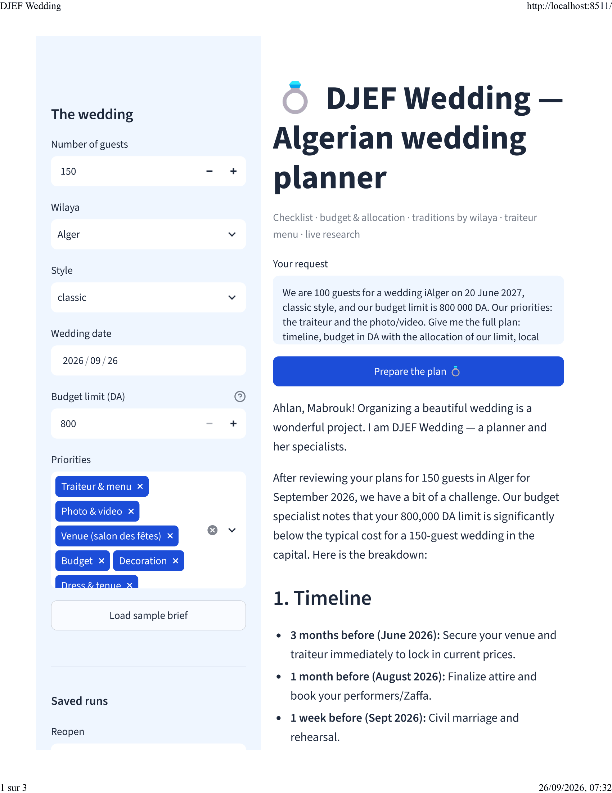

# 📘 LangChain — Module 2: Advanced Agent

> **Learning path:** LangChain & LangGraph, from a single model call to a stateful AI assistant.
> **Author:** Kassouar Fatima 🇩🇿
> **Stack:** Python · LangChain · LangGraph · Gemini · MCP

This folder holds **Module 2 of the LangChain path** — "Advanced Agent". It continues
exactly where **Module 1 - Create Agent** stopped: same style, same model, same setup,
the next tool in the chain: **MCP (Model Context Protocol)**.

---

## 📂 Repository layout

```
Module 2 - Advanced Agent/
│
├── notebooks/
│   ├── README.md                         ← how to execute every notebook
│   ├── 2_1_MCP_kassouar.ipynb               ← lesson 2.1: MCP servers (local + online)
│   ├── 2_1_2_2_Travel_State_Context_kassouar.ipynb
│   │                                       ← lessons 2.1 + 2.2: travel agent (MCP/Kiwi),
│   │                                         custom state, runtime context (one notebook)
│   ├── 2_3_Multi_agent_kassouar.ipynb      ← lesson 2.3: multi-agent (specialist subagents)
│   ├── wedding_planner_kassouar.ipynb      ← the project in notebook form (bench)
│   ├── .env                                ← GOOGLE_API_KEY / GEMINI_API_KEY / LANGSMITH_*
│   └── resources/
│       └── 2_1_mcp_server.py    ← the local MCP server launched by the notebook
│
├── project_wedding_planner/
│   ├── README.md · requirements.txt      ← the Module 2 project (examples + deploy)
│   ├── run_notebook.cmd · run_app.cmd
│   ├── notebooks/
│   │   ├── wedding_planner_service.py    ← the Coordinator + 3 specialists (MCP/web/SQL)
│   │   ├── mcp_flights_server.py         ← the local flights MCP server (stdio)
│   │   └── wedding_planner_kassouar.ipynb    ← bench: MCP, SQL, delegation, test, trace
│   └── streamlit/                    ← the small app: design / components / runner / app
│
├── .env.example                 ← copy to .env and add your keys
└── README.md
```

---

## 🎓 The lessons (notebooks)

| Lesson | Title | What you learn | API key needed |
| --- | --- | --- | --- |
| `2_1` | MCP (Model Context Protocol) | Expose **tools, resources and prompts** through an MCP server; an agent consumes them (local *stdio* server + online server) | `GOOGLE_API_KEY` |
| `2_1 + 2_2` | Travel agent, State & Runtime Context | Connect the agent to a **public MCP server** over HTTP (Kiwi flight search); add your own **state fields** that tools write with `Command` and read back; pass per-run **runtime context** typed with `context_schema` (one combined notebook) | `GOOGLE_API_KEY` |
| `2_3` | Multi-agent (subagents) | Split the work: tiny **specialist subagents** each own one tool, and a **main agent** delegates to them through normal `@tool` wrappers running `subagent.invoke(...)` — its own notebook | `GOOGLE_API_KEY` |
| `project` | Wedding planner (notebook) | The module project in notebook form: a **Coordinator** dispatching to ✈️ Flights (MCP) · 🏛️ Venue (web search) · 🎵 Playlist (SQLite/SQL), then a bench over MCP · SQL · delegation · tests · trace | `GOOGLE_API_KEY` |

> 💡 Each notebook is self-contained: copy `.env.example` to `.env`, or paste the key
> in the setup cell / Colab Secrets.

📖 **Full execution guide — order, launchers, ports, prerequisites →
[`notebooks/README.md`](notebooks/README.md)**

---

## 📸 The app in action

Here is the end-of-module project (`project_wedding_planner/`):

| The app — DJEF Wedding | The plan, page 1 | The plan, page 2 |
| --- | --- | --- |
|  |  |  |

> The coordinator takes guests, wilaya, style and date, then delegates: ✈️ flights
> from a **local MCP server**, 🏛️ venue from **live web search**, 🎵 playlist from
> **SQLite** — with budget-range validation and saved runs.

📄 Full PDF walkthrough: [`project_wedding_planner/screanshot/DJEF_Wedding.pdf`](project_wedding_planner/screanshot/DJEF_Wedding.pdf)

---

## ✅ My actual work in this module

| Where | What I built |
| --- | --- |
| **Notebooks** | 3 lesson notebooks (`2_1` MCP · `2_1+2_2` travel/state/context · `2_3` multi-agent) **+** the project notebook `wedding_planner_kassouar.ipynb` — all executed with **0 error cells** — plus a README explaining how to run each one |
| **App** | **DJEF Wedding** (`project_wedding_planner/`): a Coordinator + 3 specialists, Streamlit UI, `run_notebook.cmd` / `run_app.cmd` launchers, screenshots + PDF |
| **MCP** | `resources/2_1_mcp_server.py` (lesson server) and `project_wedding_planner/notebooks/mcp_flights_server.py` (the project's flights server, stdio) |
| **Data** | `project_wedding_planner/notebooks/data/playlist.db` — seeded SQLite playlist + a `.pre-break.bak` taken before the break-it-first exercise |

---

## ▶️ How to run

1. **Create your Python environment** (same one as Module 1):
   ```bash
   uv pip install --python ".venv\Scripts\python.exe" \
       langchain langchain-google-genai langchain-mcp-adapters mcp-server-time python-dotenv
   ```
2. Copy `.env.example` to `.env` and put your `GOOGLE_API_KEY` in it.
3. Open a notebook in `notebooks/` in Jupyter and **Run All Cells**:
   - `2_1_MCP_kassouar.ipynb` — MCP servers (local + online).
   - `2_1_2_2_Travel_State_Context_kassouar.ipynb` — travel agent, custom state, runtime context.
   - `2_3_Multi_agent_kassouar.ipynb` — specialist subagents, delegation + three exercises.

> 💡 The combined notebook connects to the **public Kiwi MCP server** (`https://mcp.kiwi.com`)
> for the flight demo; it needs internet but no extra key.

> 🔑 Keys are read from `.env` (or Colab Secrets) and are **never** stored in the notebook.

---

## 📖 What is MCP?

The Model Context Protocol is an open standard that decouples *tools* from *agents*:
one MCP server (a Python script) declares what it offers — tools, resources, prompts —
and any agent on any machine can consume them over `stdio` or HTTP.
The same idea as the tools lesson (1_2), but now the tools live **outside** the agent,
and one agent can use tools from several servers.

---

## 🔑 API keys (never committed)

| Variable | Where to get it |
| --- | --- |
| `GOOGLE_API_KEY` | https://aistudio.google.com/apikey (Gemini) |

Create a local `.env` file (copy of `.env.example`) — `.env` is git-ignored, so your
keys **never** leave your machine. 🔒
---

## ✍️ Author

**By Kassouar Fatima 🇩🇿** — AI Engineering Student · Designer · Web / Mobile Developer
`ML` · `DL` · `NLP` · `Agent` · `Chatbot` · `Computer Vision` · `Autonomous AI`

- 💼 LinkedIn: [linkedin.com/in/fatima-kassouar](https://linkedin.com/in/fatima-kassouar)
- 🐙 GitHub: [github.com/KassouarFatima](https://github.com/KassouarFatima)
- 📧 Email: [kassouarfatima20@gmail.com](mailto:kassouarfatima20@gmail.com)
