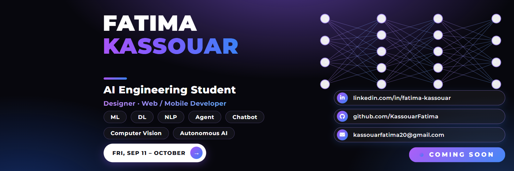

# 💍 Wedding planner — an Algerian wedding

> **Module 2 project** (Advanced Agent): a **multi-agent team** — the lesson `2_3`
> wiring applied to a real project — built from the **Coordinator Agent** spec:
> one **coordinator** that does not do the work itself: it delegates to three
> **specialists** — flights (an **MCP server**), venues (**live web search**) and
> the playlist (**SQL**) — each hidden behind an ordinary `@tool`. Notebook +
> small Streamlit app, sharing one service module.



## 📄 The project sheet — [DJEF_Wedding.pdf](screanshot/DJEF_Wedding.pdf)

The full wedding plan the app produces, printed to PDF — **3 pages**
(click the link to open the PDF):

| page 1 | page 2 | page 3 |
| --- | --- | --- |
|  |  |  |

## What it does

The coordinator extracts four parameters — `Origin`, `Destination`,
`Guest_Count`, `Genre` — **validates** them (asks when one is missing),
**dispatches** the matching specialists and **synthesizes** one answer shaped:

- ✈️ **Flights:** …
- 🏛️ **Venue:** …
- 🎵 **Playlist:** …

| specialist | its real tool | parameter mapping |
|---|---|---|
| **flights** | `search_flights` — served by the local **MCP server** `mcp_flights_server.py` (stdio) | `Origin` |
| **venue** | `web_search` — **live web search** (Tavily) | `Destination`, `Guest_Count` |
| **playlist** | `run_sql` — **SELECT-only SQL** over the SQLite database `notebooks/data/playlist.db` | `Genre` |

The app keeps its **wedding sidebar exactly as it was** — guests, wilaya, style,
wedding date, budget limit, priorities, saved runs — and **adds two inputs**:
**Origin** (where guests fly in from) and **Playlist genre**. The Wilaya doubles
as `Destination`, the guest count as `Guest_Count`; the remaining facts ride
along as context (budget for the venues, style/date for the plan).

### The SQL database — created and connected automatically

The playlist lives in a real **SQLite** file: `notebooks/data/playlist.db`
(SQLite *is* the file — there is no database server to install). Four steps,
exactly what the notebook shows by hand:

```python
con = sqlite3.connect("data/playlist.db")               # CONNECT
con.execute("CREATE TABLE IF NOT EXISTS tracks (...)")   # CREATE (first run)
con.executemany("INSERT INTO tracks ...", SEED)          # SEED (demo rows)
con.execute("SELECT ... WHERE genre LIKE '%chaabi%'")    # QUERY (agent's tool)
```

You run those four steps inside notebook section **3. Playlist**; the service
runs the same CREATE + seed for you on first use (`ensure_playlist_db`), so the
app always finds the same database. The Playlist Agent's tool only ever runs
`SELECT` — every write attempt is refused.

## Layout

```
project_wedding_planner/
├── README.md                        ← this file
├── .env                             ← GOOGLE_API_KEY (+ TAVILY_API_KEY) — local only
├── requirements.txt                 ← install this on any machine (app + notebook)
├── run_notebook.cmd                 ← double-click: opens Jupyter Lab on the notebook
├── run_app.cmd                      ← double-click: starts the Streamlit app (port 8511)
├── .streamlit/
│   └── config.toml                  ← blue & white theme
├── notebooks/
│   ├── wedding_planner_service.py   ← coordinator + 3 specialists + the tools (shared)
│   ├── mcp_flights_server.py        ← the local MCP server (stdio) behind the flights
│   ├── data/playlist.db             ← SQLite playlist DB (created + seeded on first run)
│   └── wedding_planner_kassouar.ipynb  ← the bench: MCP, web, SQL, team, test, trace
└── streamlit/                       ← the app, divided into small parts
    ├── design.py                    ← the look (page, header, footer)
    ├── components.py                ← one widget / button per function
    ├── runner.py                    ← the functionality (keys, team, context, saved runs)
    └── app.py                       ← only the assembly
```

## How to run

**1. Environment** — the same `djef` environment as Module 1/2, plus Streamlit
and the MCP/web-search packages. Simplest: install the lock-list file:

```bash
pip install -r requirements.txt
```

**2. Key** — `.env` in this folder (never inside a cell):

```
GOOGLE_API_KEY=AQ....
TAVILY_API_KEY=tvly-...        ← for the venue specialist (live web search)
```

**3. Notebook** — double-click **`run_notebook.cmd`** → Jupyter Lab opens on the
`notebooks` folder → open `wedding_planner_kassouar.ipynb` → **Run All Cells**
(kernel `djef`). The keys load from the project `.env` automatically (no prompt).
Model: `google_genai:gemini-3.1-flash-lite`.

**4. App** — double-click **`run_app.cmd`** → the launcher first opens the
playlist database **directly** (you should see
`[DB] direct connection OK -> …\data\playlist.db | tracks: 28`) and then the
browser opens on `http://localhost:8511` (blue & white, English). Or manually,
from *this* folder:

```bash
streamlit run streamlit/app.py
```

Fill the sidebar — the old fields (guests, wilaya, style, date, **budget limit**,
**priorities**) plus the two new ones (**Origin**, **Playlist genre**) — press
**Load sample brief** for a ready-made example, then **Prepare the plan** — the
team answers in English after ~20–40 seconds. You can **reopen this session's
saved runs** from the sidebar and **download any plan as a `.md`** file.

## 🚀 Deploy (run it on a machine that isn't yours)

**Option A — any Windows PC (offline, simplest):** copy the project folder, then

```bash
pip install -r requirements.txt     # installs streamlit, langchain, mcp, tavily…
# put your .env next to run_app.cmd, then double-click run_app.cmd
```

The MCP server and the SQLite database travel inside `notebooks/` and are
recreated automatically if missing.

**Option B — Streamlit Community Cloud (free public link):** this needs the
project in a GitHub repository (say the word and I will *not* push anything —
this stays local until you decide):

1. push `project_wedding_planner/` to a GitHub repo;
2. share.streamlit.io → *Deploy an app* → point it at `streamlit/app.py`;
3. *App settings → Secrets* → add `GOOGLE_API_KEY` and `TAVILY_API_KEY`
   (same `.env` rule: keys never sit in the code);
4. `requirements.txt` is installed automatically — the app boots on port 8501.

## ✍️ Examples to type in the app

| # | Sidebar | Your request |
|---|---|---|
| 1 | 100 guests · Tlemcen · classic · Origin Paris · Chaabi | `Give me the full plan: timeline, budget in DA, traditions of Tlemcen and the traiteur menu — plus the flights from Paris, a venue in Tlemcen for 100 guests and the chaabi playlist.` |
| 2 | any | `Origin: Lyon, Destination: Oran, Guest_Count: 250, Genre: rai — plan our event.` |
| 3 | 300 guests · Alger · Electro | `Find me a nice venue.` ← missing Origin & Genre: the coordinator **asks** for them (workflow step 2) |
| 4 | any | `Only the playlist: a chaabi list for the party.` |

Example 1 is the showcase: all four parameters → the coordinator calls
**ask_flights, ask_venues and ask_playlist in one turn** and compiles the
✈️ 🏛️ 🎵 answer. Example 3 shows the **validation** step. Flights come from the
MCP server's **demo dataset** (indicative prices), venues from **live web
results**, the playlist from the local database.

## ⚠️ Troubleshooting

| Symptom | Cause | Fix |
|---|---|---|
| `No module named 'langchain_core.utils._gateway'` | the app/notebook ran with **Anaconda** Python instead of the DJEF environment (Anaconda ships a broken `langchain` mix) | App → use **`run_app.cmd`**. Notebook → **Kernel → Change kernel → Python (djef)**, Run All |
| `No module named 'wedding_planner_service'` | kernel started outside the project | already fixed — the Setup cell finds the folder by itself; just restart the kernel and Run All |
| A key prompt appears | `.env` not found | keep `.env` in the project folder and start with the `.cmd` files |
| The answer says *“live search is not configured”* | `TAVILY_API_KEY` missing from `.env` | add the key (same value as the Chef project); flights + playlist work without it |
| MCP tools missing / an old error after an edit | the running app still holds the previous module versions | close it and double-click **`run_app.cmd`** again (a fresh start reloads everything) |
| `fileno()` / event-loop error around MCP in Jupyter | Windows + Jupyter default loop can't launch stdio servers | already fixed — the notebook applies the **lesson 2_1 Windows fixes** cell (Proactor loop + stderr restore) before touching the MCP tools |

The environment guard is built in: the app shows a blue friendly message (no
traceback), the notebook raises *“Kernel → Change kernel → Python (djef)”*
instead of an import error.

## Note on the data

Flight rows are a **demo dataset** served by the MCP server (indicative DA
prices — not a live quote); venue results are live web links; playlist rows are
teaching data. Wedding figures (budget, portions, customs) remain **typical
indicative examples** — adjust them to the real price list and local customs
before the big day.

---

Author: **Kassouar Fatima 🇩🇿** — 26-09-2026

---

## ✍️ Author

**Fatima Kassouar** — AI Engineering Student · Designer · Web / Mobile Developer
`ML` · `DL` · `NLP` · `Agent` · `Chatbot` · `Computer Vision` · `Autonomous AI`

- 💼 LinkedIn: [linkedin.com/in/fatima-kassouar](https://linkedin.com/in/fatima-kassouar)
- 🐙 GitHub: [github.com/KassouarFatima](https://github.com/KassouarFatima)
- 📧 Email: [kassouarfatima20@gmail.com](mailto:kassouarfatima20@gmail.com)
