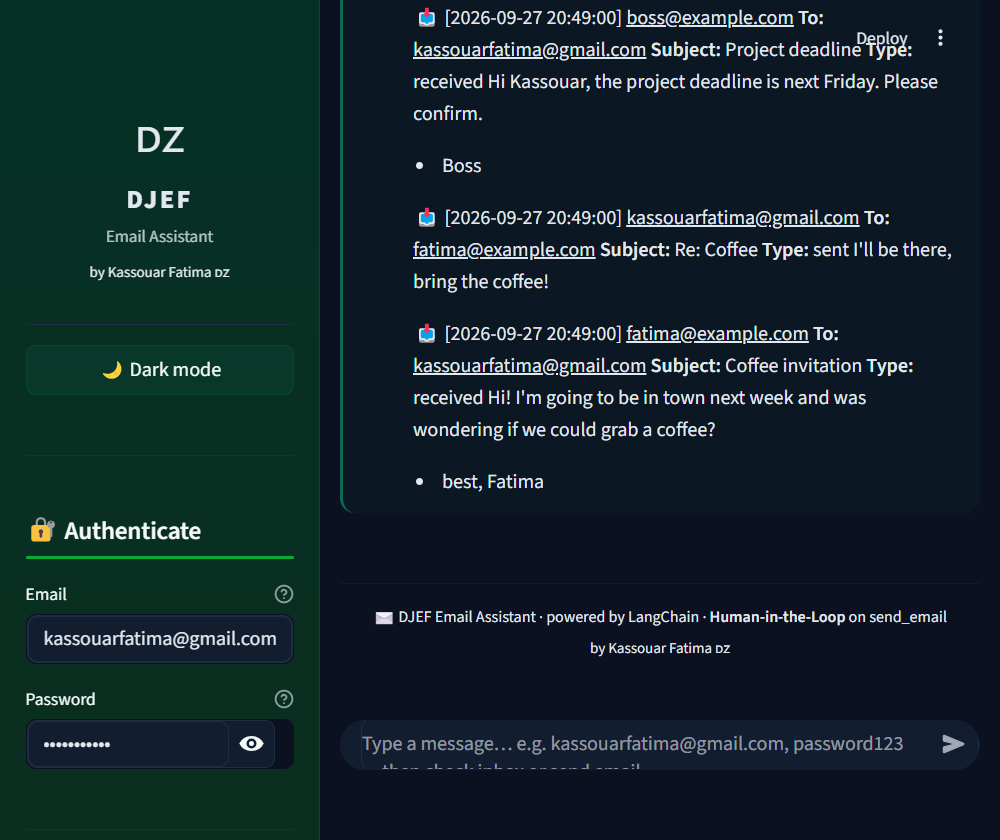

# 🇩🇿 Module 3 — Production-Ready Agent

**by Kassouar Fatima 🇩🇿 — Module 3 — Production-Ready Agent**

Where a working agent becomes a **production-ready** one. Eight notebooks teach one
idea at a time, and the final pattern — dynamic model + dynamic prompt + dynamic
tools + checkpoints + a Human-in-the-Loop door — ships as the **DJEF Email
Assistant** Streamlit app.

---

## 📸 Screenshot



*The agent answering `kassouarfatima@gmail.com, password123` — the demo inbox comes
back on the dark `#0b1120` background. Full set: [`screenshots/`](screenshots).*

---

## 🗂 What's in this module

| Folder | What it is | How to open it |
| --- | --- | --- |
| [`notebooks/`](notebooks/README.md) | The **8 lesson notebooks** `3_0` → `3_5` (+ the three `3_4_*`) | **[`notebooks/README.md`](notebooks/README.md)** — one `run_3_x.cmd` per notebook |
| [`chatui_emailassistent/`](chatui_emailassistent/README.md) | The **DJEF Email Assistant app** + its lab notebook | **[`chatui_emailassistent/README.md](chatui_emailassistent/README.md)** — `run_app.cmd` |
| [`screenshots/`](screenshots) | App screenshots used by this README and the main one | — |

---

## 📚 The notebooks — my actual work

| # | Notebook | What it teaches | API key |
| --- | --- | --- | --- |
| **3_0** | `Break it first` | Break a naive agent on purpose, capture **what** failed and **why** → `3_0_Break_it_first_results.json` | ✅ ~6 min |
| **3_1** | `Where your agent needs a door` | **Middleware & interrupts** — decide which actions must stop for a human. Audits 3_0's file, so **run 3_0 first** | ❌ no key |
| **3_2** | `Managing messages` | Summarize + trim long conversations so context never overflows | ✅ ~1 min |
| **3_3** | `Human in the loop` | `HumanInTheLoopMiddleware` — the run **stops**, a human approves / rejects / **edits**, then it resumes | ✅ ~1 min |
| **3_4a** | `Dynamic models` | Pick the model **per request**, not per agent | ✅ |
| **3_4b** | `Dynamic prompts` | Build the system prompt **at call time** from context (the Algerian voice) | ✅ |
| **3_4c** | `Dynamic tools` | A different **toolbox per role** — the pattern behind `authenticate` / `check_inbox` / `send_email` | ✅ |
| **3_5** | `Email agent` | **Every Module 3 pattern in one agent** — `InMemorySaver`, `state_schema`, `context_schema`, HITL on `send_email` | ✅ ~1 min |

> **How to execute:** double-click a `run_3_x.cmd` in
> [`notebooks/`](notebooks/README.md) → Jupyter Lab opens → **Run ▶ Run All Cells**.
> Kernels run top-to-bottom; async cells use **top-level `await`** (a Jupyter kernel
> already has a running event loop). Full detail in the
> [notebooks README](notebooks/README.md).

---

## 📧 The app — DJEF Email Assistant

> **Djazair Email Facilitator** — an Algerian-themed email assistant with a
> **Human-in-the-Loop door** on `send_email`.

### What it does

1. **Authenticate** → `authenticate` only (the doorman prompt, `check_inbox` and
   `send_email` are not even attached yet)
2. **Check inbox** → all three tools available, mailbox read from the demo store
   or real Gmail
3. **Send email** → `HumanInTheLoopMiddleware` **stops the run** with
   `⏸️ Pending draft` and three buttons: **✅ Approve · ✏️ Edit · ❌ Reject**
4. **Approve / Edit / Reject** → the run resumes and finishes (or sends nothing)

### Run it

```powershell
cd "C:\Users\Kassouar Fatima\Downloads\LangChain\Module 3 - Production-Ready Agent\chatui_emailassistent"
& ".\run_app.cmd"          # http://localhost:8519
```

Default credentials: `kassouarfatima@gmail.com` / `password123`.
Mail runs in **demo mode** by default; add a Gmail App Password to
`EMAIL_PASSWORD` to go live (see the [app README — Mail modes](chatui_emailassistent/README.md#mail-modes--and-the-fix-for-the-imap-error)).

### Structure

```
chatui_emailassistent/
├── run_app.cmd                  # launcher (port 8519)
├── README.md                    # full app docs + examples
├── requirements.txt
├── .env.example                 # incl. MAIL_MODE / EMAIL_* block
├── screanshots/                 # DJEF Email Assistant.pdf
└── streamlit/
    ├── app.py                   # main app
    ├── runner.py                # agent invocation + HITL + mail status
    ├── components.py            # UI widgets (sidebar, chat, buttons)
    ├── design.py                # dark Algerian theme (CSS)
    ├── email_agent_service.py   # agent + tools + mail transport + fixes
    ├── 3.5_email_agent.ipynb    # lab notebook (37 cells, executed, 0 errors)
    ├── 3.5_email_agent.py       # plain-Python version
    └── .streamlit/config.toml   # dark theme + fileWatcherType=none
```

---

## ✅ What I added to this module

| # | What | Where |
|---|------|-------|
| 1 | **IMAP fix** — never opens a socket without a real password; `MAIL_MODE=auto\|real\|simulated`, `_DEMO_PASSWORDS`, `.env` mtime re-read | `email_agent_service.py` |
| 2 | **Live mail status in the sidebar** (`mail_mode_status()` inside `sidebar_auth()`) | `components.py`, `runner.py` |
| 3 | **Theme fix** — `theme_css()` now renders with `st.markdown()` each run instead of a cached `st.empty()` global that went stale and dropped the `<style>` (the "text doesn't show / white background" bug) | `design.py` |
| 4 | **`streamlit/.streamlit/config.toml`** — dark theme + `fileWatcherType = "none"` (the old copy sat one level too high and was never read) | new file |
| 5 | **`--server.fileWatcherType none`** on the launcher so an external `app.py` save can't abort a chat run mid-reply | `run_app.cmd` |
| 6 | **Removed `— بيكي خير`** from the hero subtitle | `design.py` |
| 7 | **`3.5_email_agent.ipynb`** — 37 cells, executed top-to-bottom, **0 error cells**, outputs shipped | `streamlit/` |
| 8 | **This README + the [notebooks README](notebooks/README.md)** (both had been deleted) | module root, `notebooks/` |
| 9 | **`screenshots/01_chat_inbox.png`** — re-created the deleted screenshots folder | `screenshots/` |

---

## 🧭 Suggested walkthrough

| Step | You type | You see |
|---|---|---|
| 1 | `kassouarfatima@gmail.com, password123` | `Marhaba! Successfully authenticated! Welcome to DJEF. ✉️🇩🇿` |
| 2 | `check my inbox` | `📬 Your Inbox — Marhaba! 🇩🇿📬` + messages |
| 3 | `send an email to someone@example.com saying hello` | `⏸️ Pending draft` + **✅ Approve · ✏️ Edit · ❌ Reject** |
| 4 | ✅ Approve | `Marhaba! Your email has been sent successfully!` |
| 5 | 📬 Show all emails | everything above, sent and received |

---

## 🔗 Links

- **App code:** [`chatui_emailassistent/`](chatui_emailassistent/README.md)
- **Notebooks:** [`notebooks/`](notebooks/README.md)
- **Back to:** [main README](../README.md)

---

🇩🇿 **by Kassouar Fatima 🇩🇿** · Module 3 — Production-Ready Agent
